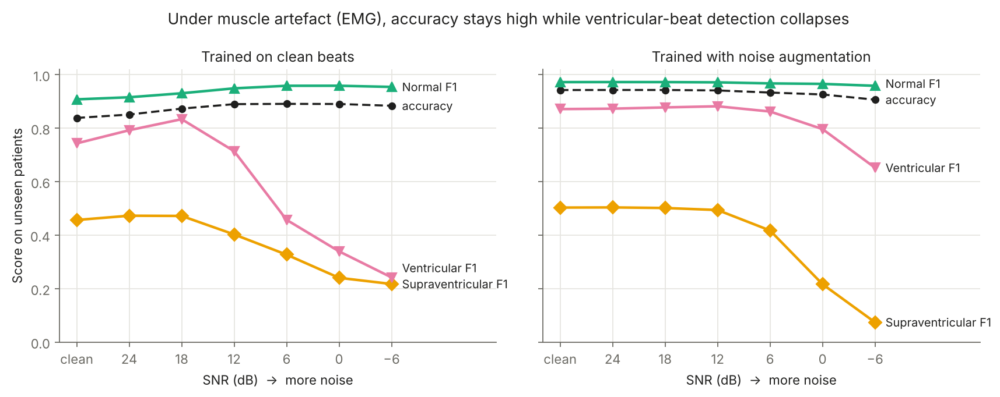

# When Does an ECG Classifier Stop Being Trustworthy?

**A noise-robustness and calibration audit of deep-learning heartbeat classification under real recorded interference.**

Author: [Zubair](https://github.com/Zubair-DLCS) · University of Malakand

---

## Question

Deep-learning ECG classifiers report high accuracy on clean benchmark data. Wearable and ambulatory ECG is rarely clean: patients move, muscles fire and electrodes shift. This project asks three questions:

1. **Robustness.** How fast does beat classification degrade as real ECG noise increases, and which noise type hurts most?
2. **Calibration.** When the model is wrong under noise, does its confidence drop — or does it stay confidently wrong?
3. **Selective prediction.** If the model may abstain on beats it is unsure about, can it keep high performance on the beats it does classify?

A model that knows when it should not be trusted is safer than one that is only accurate on average.

## Method

| Component | Choice | Why |
|---|---|---|
| Data | [MIT-BIH Arrhythmia Database](https://physionet.org/content/mitdb/1.0.0/) | Standard benchmark, 48 half-hour two-lead recordings |
| Noise | [MIT-BIH Noise Stress Test Database](https://physionet.org/content/nstdb/1.0.0/) | **Real recorded** baseline wander, muscle artefact (EMG) and electrode motion — not synthetic Gaussian noise |
| Classes | AAMI EC57: N, S, V, F | Clinical standard grouping |
| Split | Inter-patient DS1 → DS2 (de Chazal et al., 2004) | Train and test patients never overlap, avoiding the leakage that inflates many published results |
| Noise split | First half of each noise record for training, second half for testing | Test-time noise is never seen in training |
| Model | 4-block 1D CNN on the beat waveform (~60k parameters), fused with a small MLP on six RR-interval timing features; weighted cross-entropy | Small enough for a laptop CPU; RR timing is the standard cue for premature (S, V) beats |
| RR features | pre-RR, post-RR, local mean of 10 RRs, and the three ratios between them | Normalise for each patient's own heart rate (de Chazal et al., 2004) |
| SNR levels | clean, 24, 18, 12, 6, 0, −6 dB | Covers mild to severe interference |
| Calibration | Expected Calibration Error (15 bins); temperature scaling fitted on held-out DS1 records | Standard post-hoc fix (Guo et al., 2017) |
| Selective prediction | Max-softmax abstention; macro-F1 vs coverage; AURC | Risk–coverage evaluation (Geifman & El-Yaniv, 2017) |
| Mitigation | Second model trained with NSTDB noise augmentation at random SNR in [−6, 24] dB | Tests whether training-time exposure fixes both accuracy and calibration |

Noise is added to the raw beat at a target SNR, then each beat is z-normalised, so the model sees what a real device would. RR features come from the reference R-peak annotations, so noise affects the waveform but not the timing; robustness of R-peak detection itself is out of scope.

```
SNR_dB = 10 · log10( P_signal / P_noise )
noise_scale = sqrt( P_signal / (P_noise · 10^(SNR_dB/10)) )
```

## Results

Full MIT-BIH run, inter-patient: train on DS1, test on DS2 (22 unseen patients, 49,686 beats: N 44,241 · S 1,837 · V 3,220 · F 388), seed 0. Every condition is in [`results/metrics.json`](results/metrics.json).

**Clean test data.** Adding RR timing to the waveform raised macro-F1 from 0.39 to 0.53 (clean-trained) and from 0.44 to 0.59 (noise-augmented). The augmented model reaches F1 0.97 on Normal, 0.87 on Ventricular and 0.50 on Supraventricular beats. Fusion (F) beats stay near zero, a known difficulty with only 388 test beats, and they pull macro-F1 down.

| Test condition | Model | Accuracy | Macro-F1 | V-beat F1 | S-beat F1 | ECE |
|---|---|---|---|---|---|---|
| Clean | clean-trained | 0.84 | 0.53 | 0.74 | 0.46 | 0.03 |
| Clean | noise-augmented | 0.94 | 0.59 | 0.87 | 0.50 | 0.06 |
| Muscle artefact, 0 dB | clean-trained | 0.89 | 0.39 | 0.34 | 0.24 | 0.04 |
| Muscle artefact, 0 dB | noise-augmented | 0.93 | 0.51 | 0.80 | 0.22 | 0.05 |
| Muscle artefact, −6 dB | clean-trained | 0.88 | 0.36 | 0.24 | 0.22 | 0.05 |
| Muscle artefact, −6 dB | noise-augmented | 0.91 | 0.43 | 0.65 | 0.07 | 0.07 |
| Electrode motion, −6 dB | clean-trained | 0.82 | 0.40 | 0.43 | 0.22 | 0.02 |
| Electrode motion, −6 dB | noise-augmented | 0.72 | 0.30 | 0.33 | 0.02 | 0.04 |

**Figure 1 — Accuracy against per-class F1 under muscle artefact.** The headline result: the averages stay flat while rare-beat detection falls away.



**Figure 2 — Macro-F1 and calibration error versus SNR, per noise type.**


**Figure 3 — Reliability diagrams for the clean-trained model, clean versus muscle artefact at 0 dB.**


**Figure 4 — Selective prediction at electrode motion 6 dB: performance when the model may abstain on uncertain beats.**


### Key findings

1. **Muscle noise causes a failure that standard metrics miss.** For the clean-trained model, from clean data to −6 dB, accuracy *rises* from 0.84 to 0.88 and confidence from 0.86 to 0.93. Calibration error stays at or below 0.05 throughout. Meanwhile ventricular-beat F1 falls from 0.74 to 0.24, a two-thirds drop on the clinically most important class. Accuracy, confidence and ECE all report a healthy model.
2. **Noise augmentation protects one class and sacrifices another.** At muscle artefact −6 dB it keeps ventricular F1 at 0.65 instead of 0.24, but supraventricular F1 falls to 0.07 instead of 0.22. Under baseline wander −6 dB it falls to 0.01. No single model is robust across classes, so per-class reporting is necessary.
3. **Timing features mask waveform damage.** Under electrode motion at −6 dB, adding RR timing raised macro-F1 from 0.15 to 0.40 and cut calibration error from 0.44 to 0.02. Because RR intervals here come from reference annotations, this is an upper bound: on a real device the same noise would also disrupt R-peak detection.
4. **Post-hoc calibration does not transfer reliably across patients.** Temperature scaling fitted on held-out training patients made the clean-trained model worse on new patients (ECE 0.03 → 0.09) and the augmented model better (0.06 → 0.02). The same pattern appeared in the waveform-only version.

### Ablation: waveform only (version 1)

Results without RR features are kept in [`results_v1_morphology_only/`](results_v1_morphology_only/); reproduce with `python run.py --no-rr`. Clean-data macro-F1 was 0.39 (clean-trained) and 0.44 (augmented). The hidden-failure pattern of finding 1 was already present there: under muscle artefact at −6 dB, accuracy rose to 0.87 while macro-F1 fell from 0.39 to 0.25.

## Run it

**Google Colab (free, no setup):** open [`colab.ipynb`](colab.ipynb) and run all cells.

**Locally:**

```bash
git clone https://github.com/Zubair-DLCS/Noise-robust-ECG-classification.git
cd Noise-robust-ECG-classification
pip install -r requirements.txt

python run.py --synthetic   # ~20 s smoke test, no download
python run.py               # full study (waveform + RR); downloads ~100 MB from PhysioNet on first run
python run.py --no-rr       # version 1 ablation: waveform only
```

Outputs go to `results/`: `metrics.json` (every model × noise × SNR × calibration row) and three figures.

## Repository structure

```
ecgrobust/
  data.py        MIT-BIH / NSTDB loading, AAMI mapping, inter-patient split, RR features, SNR-controlled noise injection
  model.py       1D CNN + RR-feature MLP, training loop, temperature scaling
  metrics.py     macro-F1, ECE, reliability bins, risk–coverage / AURC
  synthetic.py   synthetic beats and noise for the smoke test only
run.py           end-to-end experiment
figures.py       result figures
colab.ipynb      one-click Colab runner
```

## Limitations and next steps

- RR intervals come from reference R-peak annotations. Running a real R-peak detector on the noisy signal is the most important next step.
- Fusion (F) beats are almost never recognised; class-balanced sampling or focal loss may help.
- Single lead (MLII) and a single small CNN; larger models and both leads are natural extensions.
- One seed; repeated runs with confidence intervals are needed before strong claims.
- Max-softmax confidence is a simple baseline; Monte Carlo dropout, deep ensembles and conformal prediction are planned comparisons.
- Noise is added at fixed SNR per condition; real recordings mix noise types and vary over time.
- The same audit framework applies to other safety-critical signals, such as RF spectrograms under jamming.

## References

- Moody, G. B., & Mark, R. G. (2001). The impact of the MIT-BIH Arrhythmia Database. *IEEE Engineering in Medicine and Biology Magazine*, 20(3), 45–50.
- Moody, G. B., Muldrow, W., & Mark, R. G. (1984). A noise stress test for arrhythmia detectors. *Computers in Cardiology*, 11, 381–384.
- de Chazal, P., O'Dwyer, M., & Reilly, R. B. (2004). Automatic classification of heartbeats using ECG morphology and heartbeat interval features. *IEEE Transactions on Biomedical Engineering*, 51(7), 1196–1206.
- Guo, C., Pleiss, G., Sun, Y., & Weinberger, K. Q. (2017). On calibration of modern neural networks. *ICML*.
- Geifman, Y., & El-Yaniv, R. (2017). Selective classification for deep neural networks. *NeurIPS*.
- Goldberger, A. L., et al. (2000). PhysioBank, PhysioToolkit, and PhysioNet. *Circulation*, 101(23), e215–e220.

## License

Code: MIT. The PhysioNet databases are distributed under the Open Data Commons Attribution License v1.0.
