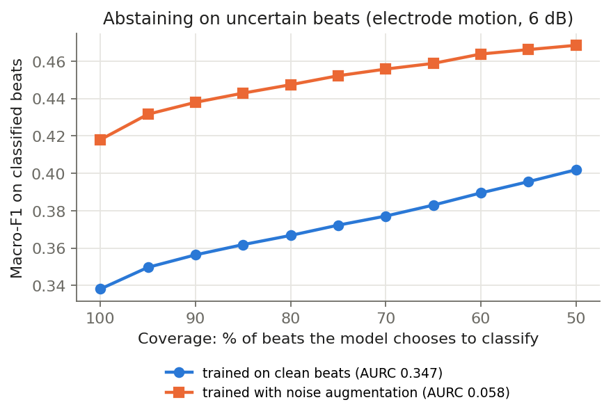

# When Does an ECG Classifier Stop Being Trustworthy?

**A noise-robustness and calibration audit of deep-learning heartbeat classification under real recorded interference.**

Author: [Zubair](https://github.com/Zubair-DLCS) · University of Malakand

---

## Question

Deep-learning ECG classifiers report high accuracy on clean benchmark data. Wearable and ambulatory ECG is rarely clean: patients move, muscles fire and electrodes shift. This project asks three questions:

1. **Robustness.** How fast does beat classification degrade as real ECG noise increases, and which noise type hurts most?
2. **Calibration.** When the model is wrong under noise, does its confidence drop — or does it stay confidently wrong?
3. **Selective prediction.** If the model may abstain on beats it is unsure about, can it keep high performance on the beats it does classify?

A model that knows when it should not be trusted is safer than one that is only accurate on average.

## Method

| Component | Choice | Why |
|---|---|---|
| Data | [MIT-BIH Arrhythmia Database](https://physionet.org/content/mitdb/1.0.0/) | Standard benchmark, 48 half-hour two-lead recordings |
| Noise | [MIT-BIH Noise Stress Test Database](https://physionet.org/content/nstdb/1.0.0/) | **Real recorded** baseline wander, muscle artefact (EMG) and electrode motion — not synthetic Gaussian noise |
| Classes | AAMI EC57: N, S, V, F | Clinical standard grouping |
| Split | Inter-patient DS1 → DS2 (de Chazal et al., 2004) | Train and test patients never overlap, avoiding the leakage that inflates many published results |
| Noise split | First half of each noise record for training, second half for testing | Test-time noise is never seen in training |
| Model | 4-block 1D CNN on the beat waveform (~60k parameters), fused with a small MLP on six RR-interval timing features; weighted cross-entropy | Small enough for a laptop CPU; RR timing is the standard cue for premature (S, V) beats |
| RR features | pre-RR, post-RR, local mean of 10 RRs, and the three ratios between them | Normalise for each patient's own heart rate (de Chazal et al., 2004) |
| SNR levels | clean, 24, 18, 12, 6, 0, −6 dB | Covers mild to severe interference |
| Calibration | Expected Calibration Error (15 bins); temperature scaling fitted on held-out DS1 records | Standard post-hoc fix (Guo et al., 2017) |
| Selective prediction | Max-softmax abstention; macro-F1 vs coverage; AURC | Risk–coverage evaluation (Geifman & El-Yaniv, 2017) |
| Mitigation | Second model trained with NSTDB noise augmentation at random SNR in [−6, 24] dB | Tests whether training-time exposure fixes both accuracy and calibration |

Noise is added to the raw beat at a target SNR, then each beat is z-normalised, so the model sees what a real device would. RR features come from the reference R-peak annotations, so noise affects the waveform but not the timing; robustness of R-peak detection itself is out of scope.

```
SNR_dB = 10 · log10( P_signal / P_noise )
noise_scale = sqrt( P_signal / (P_noise · 10^(SNR_dB/10)) )
```

## Results

> **Version 2 (waveform + RR timing) is being re-run.** The table, figures and findings below are from **version 1 (waveform only)**, kept in [`results_v1_morphology_only/`](results_v1_morphology_only/) as an ablation. Reproduce it with `python run.py --no-rr`.

Version 1, full MIT-BIH run, inter-patient (train DS1, test DS2 = 22 unseen patients), seed 0.

| Test condition | Model | Accuracy | Macro-F1 | ECE | Mean confidence |
|---|---|---|---|---|---|
| Clean | clean-trained | 0.68 | 0.39 | 0.10 | 0.78 |
| Clean | noise-augmented | 0.90 | 0.44 | 0.05 | 0.87 |
| Electrode motion, 0 dB | clean-trained | 0.42 | 0.26 | 0.29 | 0.70 |
| Electrode motion, 0 dB | noise-augmented | 0.78 | 0.37 | 0.04 | 0.75 |
| Muscle artefact, −6 dB | clean-trained | 0.87 | 0.25 | 0.07 | 0.92 |
| Muscle artefact, −6 dB | noise-augmented | 0.59 | 0.27 | 0.07 | 0.53 |

**Figure 1 — Macro-F1 and calibration error versus SNR, per noise type.**


**Figure 2 — Reliability diagrams for the clean-trained model.** Under muscle artefact at 0 dB the curve sits close to the diagonal, so the model *looks* well calibrated, yet macro-F1 has fallen to 0.27: it is confidently right on Normal beats and misses rare ones. Temperature scaling (fitted on other patients) pulls both curves further from the diagonal.


**Figure 3 — Selective prediction: performance when the model may abstain on uncertain beats.**



### Key findings

1. **Electrode motion is the most dangerous noise, and the model stays confident while failing.** For the clean-trained model, accuracy falls from 0.68 to 0.24 between clean and −6 dB, but mean confidence only drops from 0.78 to 0.67. Calibration error rises more than fourfold (ECE 0.10 → 0.44).
2. **Accuracy hides failure under muscle artefact.** At −6 dB, accuracy *rises* to 0.87 and confidence to 0.92, yet macro-F1 falls from 0.39 to 0.25. The model collapses onto the majority Normal class, which is 89% of test beats. Accuracy and ECE both look healthy; only per-class metrics reveal the failure.
3. **Noise augmentation helps across the board up to 0 dB.** At electrode motion 0 dB it lifts macro-F1 from 0.26 to 0.37 and cuts ECE from 0.29 to 0.04. It also improves clean-data performance (macro-F1 0.39 → 0.44). At −6 dB baseline wander and muscle artefact it no longer helps.
4. **Post-hoc calibration does not transfer across patients.** Temperature scaling fitted on held-out *training* patients made the clean-trained model worse on new patients (clean-data ECE 0.10 → 0.21). Calibration methods validated within one patient group can mislead on another.
5. **Abstention works only for the robust model.** At electrode motion 6 dB, the area under the risk–coverage curve is 0.35 for the clean-trained model versus 0.06 for the augmented model. A model that is confidently wrong cannot safely defer.

**Caveat.** Absolute macro-F1 is modest because the model sees beat shape only. Published inter-patient systems add RR-interval timing features, which matter most for supraventricular (S) beats. Adding them is the planned next step; the robustness and calibration comparisons above are relative and do not depend on it.

## Run it

**Google Colab (free, no setup):** open [`colab.ipynb`](colab.ipynb) and run all cells.

**Locally:**

```bash
git clone https://github.com/Zubair-DLCS/Noise-robust-ECG-classification.git
cd Noise-robust-ECG-classification
pip install -r requirements.txt

python run.py --synthetic   # ~20 s smoke test, no download
python run.py               # full study (waveform + RR); downloads ~100 MB from PhysioNet on first run
python run.py --no-rr       # version 1 ablation: waveform only
```

Outputs go to `results/`: `metrics.json` (every model × noise × SNR × calibration row) and three figures.

## Repository structure

```
ecgrobust/
  data.py        MIT-BIH / NSTDB loading, AAMI mapping, inter-patient split, RR features, SNR-controlled noise injection
  model.py       1D CNN + RR-feature MLP, training loop, temperature scaling
  metrics.py     macro-F1, ECE, reliability bins, risk–coverage / AURC
  synthetic.py   synthetic beats and noise for the smoke test only
run.py           end-to-end experiment
figures.py       result figures
colab.ipynb      one-click Colab runner
```

## Limitations and next steps

- Single lead (MLII) and a single small CNN; larger models and both leads are natural extensions.
- Max-softmax confidence is a simple baseline; Monte Carlo dropout, deep ensembles and conformal prediction are planned comparisons.
- Noise is added at fixed SNR per condition; real recordings mix noise types and vary over time.
- The same audit framework applies to other safety-critical signals, such as RF spectrograms under jamming.

## References

- Moody, G. B., & Mark, R. G. (2001). The impact of the MIT-BIH Arrhythmia Database. *IEEE Engineering in Medicine and Biology Magazine*, 20(3), 45–50.
- Moody, G. B., Muldrow, W., & Mark, R. G. (1984). A noise stress test for arrhythmia detectors. *Computers in Cardiology*, 11, 381–384.
- de Chazal, P., O'Dwyer, M., & Reilly, R. B. (2004). Automatic classification of heartbeats using ECG morphology and heartbeat interval features. *IEEE Transactions on Biomedical Engineering*, 51(7), 1196–1206.
- Guo, C., Pleiss, G., Sun, Y., & Weinberger, K. Q. (2017). On calibration of modern neural networks. *ICML*.
- Geifman, Y., & El-Yaniv, R. (2017). Selective classification for deep neural networks. *NeurIPS*.
- Goldberger, A. L., et al. (2000). PhysioBank, PhysioToolkit, and PhysioNet. *Circulation*, 101(23), e215–e220.

## License

Code: MIT. The PhysioNet databases are distributed under the Open Data Commons Attribution License v1.0.
