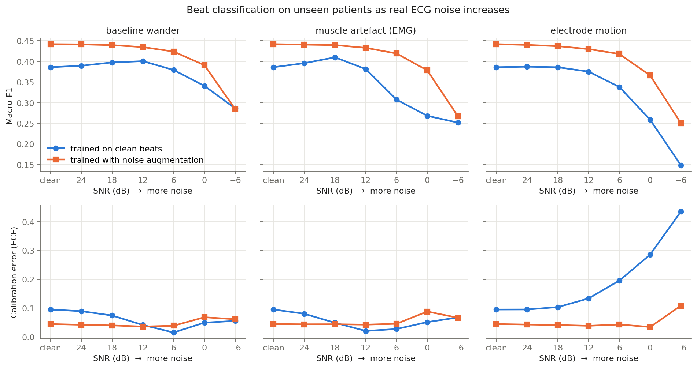
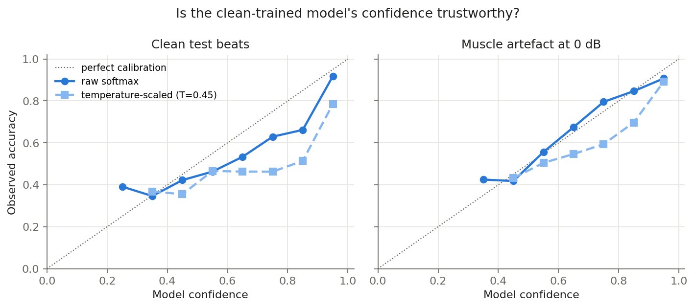
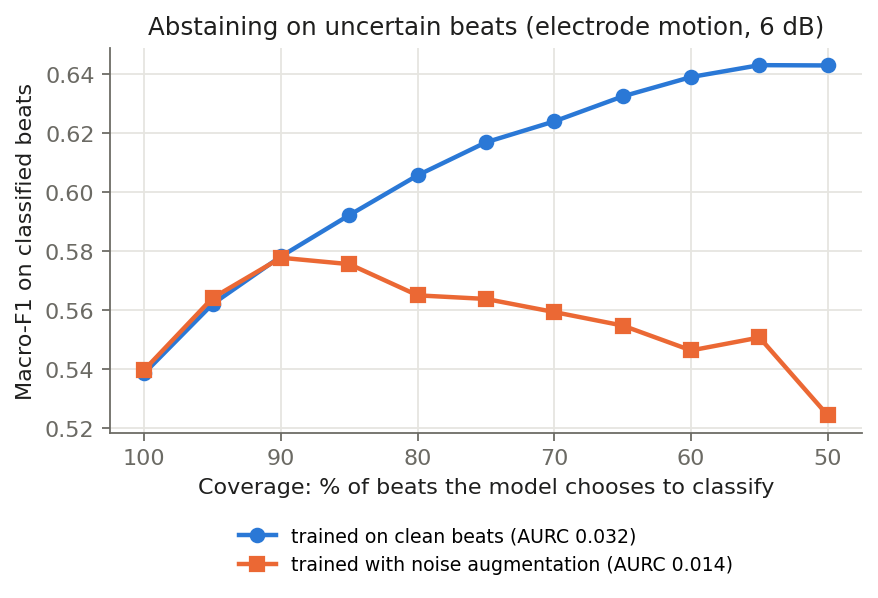

# When Does an ECG Classifier Stop Being Trustworthy?

**A noise-robustness and calibration audit of deep-learning heartbeat classification under real recorded interference.**

Author: [Zubair](https://github.com/Zubair-DLCS) · University of Malakand

---

## Question

Deep-learning ECG classifiers report high accuracy on clean benchmark data. Wearable and ambulatory ECG is rarely clean: patients move, muscles fire and electrodes shift. This project asks three questions:

1. **Robustness.** How fast does beat classification degrade as real ECG noise increases, and which noise type hurts most?
2. **Calibration.** When the model is wrong under noise, does its confidence drop — or does it stay confidently wrong?
3. **Selective prediction.** If the model may abstain on beats it is unsure about, can it keep high performance on the beats it does classify?

A model that knows when it should not be trusted is safer than one that is only accurate on average.

## Method

| Component | Choice | Why |
|---|---|---|
| Data | [MIT-BIH Arrhythmia Database](https://physionet.org/content/mitdb/1.0.0/) | Standard benchmark, 48 half-hour two-lead recordings |
| Noise | [MIT-BIH Noise Stress Test Database](https://physionet.org/content/nstdb/1.0.0/) | **Real recorded** baseline wander, muscle artefact (EMG) and electrode motion — not synthetic Gaussian noise |
| Classes | AAMI EC57: N, S, V, F | Clinical standard grouping |
| Split | Inter-patient DS1 → DS2 (de Chazal et al., 2004) | Train and test patients never overlap, avoiding the leakage that inflates many published results |
| Noise split | First half of each noise record for training, second half for testing | Test-time noise is never seen in training |
| Model | 4-block 1D CNN (~60k parameters), weighted cross-entropy | Small enough to train on a laptop CPU |
| SNR levels | clean, 24, 18, 12, 6, 0, −6 dB | Covers mild to severe interference |
| Calibration | Expected Calibration Error (15 bins); temperature scaling fitted on held-out DS1 records | Standard post-hoc fix (Guo et al., 2017) |
| Selective prediction | Max-softmax abstention; macro-F1 vs coverage; AURC | Risk–coverage evaluation (Geifman & El-Yaniv, 2017) |
| Mitigation | Second model trained with NSTDB noise augmentation at random SNR in [−6, 24] dB | Tests whether training-time exposure fixes both accuracy and calibration |

Noise is added to the raw beat at a target SNR, then each beat is z-normalised, so the model sees what a real device would.

```
SNR_dB = 10 · log10( P_signal / P_noise )
noise_scale = sqrt( P_signal / (P_noise · 10^(SNR_dB/10)) )
```

## Results

> Results below will be filled in after the full MIT-BIH run. Run `python run.py` to reproduce.

**Figure 1 — Macro-F1 and calibration error versus SNR, per noise type.**



**Figure 2 — Reliability diagrams for the clean-trained model, clean versus heavy muscle artefact.**



**Figure 3 — Selective prediction: performance when the model may abstain on uncertain beats.**



### Key findings

- _To be written from the full run._

## Run it

**Google Colab (free, no setup):** open [`colab.ipynb`](colab.ipynb) and run all cells.

**Locally:**

```bash
git clone https://github.com/Zubair-DLCS/Noise-robust-ECG-classification.git
cd Noise-robust-ECG-classification
pip install -r requirements.txt

python run.py --synthetic   # ~20 s smoke test, no download
python run.py               # full study; downloads ~110 MB from PhysioNet on first run
```

Outputs go to `results/`: `metrics.json` (every model × noise × SNR × calibration row) and three figures.

## Repository structure

```
ecgrobust/
  data.py        MIT-BIH / NSTDB loading, AAMI mapping, inter-patient split, SNR-controlled noise injection
  model.py       1D CNN, training loop, temperature scaling
  metrics.py     macro-F1, ECE, reliability bins, risk–coverage / AURC
  synthetic.py   synthetic beats and noise for the smoke test only
run.py           end-to-end experiment
figures.py       result figures
colab.ipynb      one-click Colab runner
```

## Limitations and next steps

- Single lead (MLII) and a single small CNN; larger models and both leads are natural extensions.
- Max-softmax confidence is a simple baseline; Monte Carlo dropout, deep ensembles and conformal prediction are planned comparisons.
- Noise is added at fixed SNR per condition; real recordings mix noise types and vary over time.
- The same audit framework applies to other safety-critical signals, such as RF spectrograms under jamming.

## References

- Moody, G. B., & Mark, R. G. (2001). The impact of the MIT-BIH Arrhythmia Database. *IEEE Engineering in Medicine and Biology Magazine*, 20(3), 45–50.
- Moody, G. B., Muldrow, W., & Mark, R. G. (1984). A noise stress test for arrhythmia detectors. *Computers in Cardiology*, 11, 381–384.
- de Chazal, P., O'Dwyer, M., & Reilly, R. B. (2004). Automatic classification of heartbeats using ECG morphology and heartbeat interval features. *IEEE Transactions on Biomedical Engineering*, 51(7), 1196–1206.
- Guo, C., Pleiss, G., Sun, Y., & Weinberger, K. Q. (2017). On calibration of modern neural networks. *ICML*.
- Geifman, Y., & El-Yaniv, R. (2017). Selective classification for deep neural networks. *NeurIPS*.
- Goldberger, A. L., et al. (2000). PhysioBank, PhysioToolkit, and PhysioNet. *Circulation*, 101(23), e215–e220.

## License

Code: MIT. The PhysioNet databases are distributed under the Open Data Commons Attribution License v1.0.
